# Shos.AIChatSample

**AI エージェントが参加できるグループチャット** のサンプルアプリです。

ブラウザーで開いたチャット画面に複数の人がログインして会話でき、メッセージに `@Agent` と書くと、**AI エージェント (Azure OpenAI の LLM)** が会話に加わって返事をしてくれます。AI エージェントは必要に応じて **Web 検索 (Brave Search)** も行います。

```
田中:  明日の東京の天気は? @Agent
Agent: (Web 検索した結果をもとに) 明日の東京は晴れ、最高気温は…
```

『AIエージェント開発ハンズオンセミナー』(開発者向け) の教材として作られています。

---

## 目次

1. [このリポジトリについて](#1-このリポジトリについて)
2. [プロジェクトについて](#2-プロジェクトについて)
3. [セットアップ手順](#3-セットアップ手順)
   - [3.1 必要なもの](#31-必要なもの)
   - [3.2 Azure OpenAI の準備](#32-azure-openai-の準備)
   - [3.3 Brave Search API キーの準備](#33-brave-search-api-キーの準備)
   - [3.4 ソースコードの取得](#34-ソースコードの取得)
   - [3.5 API キーなどの設定](#35-api-キーなどの設定)
   - [3.6 データベースの作成](#36-データベースの作成)
   - [3.7 起動して使ってみる](#37-起動して使ってみる)
4. [うまく動かないとき](#4-うまく動かないとき)
5. [ライセンス](#5-ライセンス)

---

## 1. このリポジトリについて

### フォルダー構成

```
Shos.AIChatSample/
├── Shos.AIChatSample.slnx      … ソリューションファイル (Visual Studio で開く)
├── Shos.AIChatSample/          … アプリ本体 (ASP.NET Core プロジェクト) ※ 2 章で詳しく説明
├── References/                 … セミナー用の資料
│   ├── tutorial.0.2.md         …   Azure OpenAI の準備手順 (画像付き)
│   └── Images/                 …   手順書の画像
├── Reviews/                    … コードレビューの記録
├── CLAUDE.md                   … AI コーディング支援 (Claude Code) 向けのメモ
├── LICENSE.txt                 … ライセンス (MIT)
└── README.md                   … このファイル
```

### 使っている主な技術

| 技術 | 何に使っているか |
|---|---|
| **.NET 10 / ASP.NET Core Razor Pages** | Web アプリの土台 (画面とサーバー処理) |
| **ASP.NET Core SignalR** | リアルタイム通信。誰かが発言すると、全員の画面に即座に表示される |
| **ASP.NET Core Identity** | ユーザー登録・ログイン |
| **Entity Framework Core + SQL Server LocalDB** | ユーザー情報とチャットログの保存 |
| **Microsoft Agent Framework** | AI エージェントを作るためのフレームワーク |
| **Azure OpenAI (gpt-5-mini)** | AI エージェントの頭脳となる LLM |
| **MCP (Model Context Protocol)** | AI エージェントに外部ツール (ここでは Web 検索) を使わせる仕組み |
| **Brave Search MCP サーバー** | Web 検索ツール。Node.js (`npx`) で起動される |

---

## 2. プロジェクトについて

### どんなアプリか

1. ユーザー登録してログインすると、チャット画面が表示されます。
2. メッセージを送ると、ログインしている全員の画面にリアルタイムで表示されます (LINE 風のふきだし)。
3. メッセージに `@Agent` を含めると、AI エージェントが返事をします。
   - 例: `@Agent 今日のニュースを教えて` / `こんにちは@Agent`
   - 大文字・小文字は区別しません (`@agent` でも OK)。
4. AI エージェントは **ユーザーごとに会話の流れを覚えています**。続けて質問すると、前の話を踏まえて答えます。
5. 「Clear」ボタンで **全員分のチャットログ** が消えます (あわせて、押した人と AI エージェントとの会話の記憶も消えます)。

### 処理の流れ

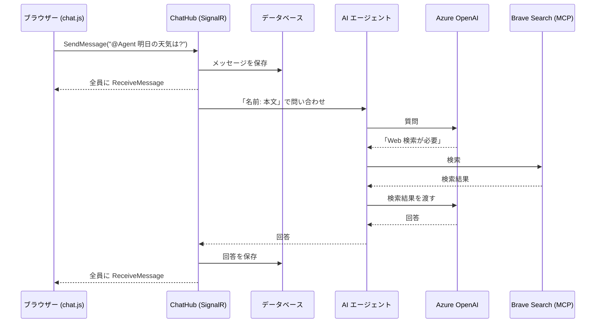

### 主なソースファイル (`Shos.AIChatSample/` 配下)

| ファイル | 役割 |
|---|---|
| `Program.cs` | アプリの起動処理。DB・認証・SignalR・AI エージェントなどを登録する |
| `Hubs/ChatHub.cs` | チャットの中心。メッセージの受信・保存・全員への配信、`@Agent` の判定と AI への問い合わせ |
| `AIAgents/ChatAgent.cs` | AI エージェント本体。Azure OpenAI への接続と、Brave Search MCP サーバーの起動 |
| `AIAgents/ChatAgentOptions.cs` | AI エージェントの接続設定 (エンドポイント・API キーなど) |
| `Services/IThreadStore.cs`, `InMemoryThreadStore.cs` | ユーザーごとの AI との会話の保存先 (メモリ上。アプリを再起動すると消える) |
| `Data/ApplicationDbContext.cs` | ユーザー情報 (Identity) の DB |
| `Data/MessagesDbContext.cs` | チャットメッセージの DB |
| `Pages/Index.cshtml` | チャット画面 |
| `Pages/Messages/RenderPartial.cshtml` | 1 件のメッセージの HTML を返すページ (新着メッセージの表示に使う) |
| `wwwroot/js/chat.js` | ブラウザー側の処理 (SignalR での送受信、画面への追加) |
| `Migrations/`, `Migrations/MessagesDb/` | DB のテーブルを作るためのマイグレーション |

> [!NOTE]
> C# の名前空間はプロジェクト名とは異なり `FCAIChat` です。

---

## 3. セットアップ手順

### 3.1 必要なもの

| 必要なもの | 用途 | 入手先 |
|---|---|---|
| **Windows** | SQL Server LocalDB を使うため | — |
| **Visual Studio 2026** (「ASP.NET と Web 開発」ワークロード) <br>または **.NET 10 SDK** | ビルドと実行。Visual Studio には LocalDB も含まれる | [Visual Studio](https://visualstudio.microsoft.com/ja/) / [.NET](https://dotnet.microsoft.com/ja-jp/download) |
| **SQL Server Express LocalDB** | データベース (Visual Studio を使わない場合は個別にインストール) | [SQL Server Express LocalDB](https://learn.microsoft.com/ja-jp/sql/database-engine/configure-windows/sql-server-express-localdb) |
| **Node.js** (LTS) | Brave Search MCP サーバーを `npx` で起動するため | [Node.js](https://nodejs.org/ja) |
| **Microsoft Azure アカウント** | Azure OpenAI を使うため | 3.2 を参照 |
| **Brave Search API キー** | Web 検索のため | 3.3 を参照 |

インストールできたかは、コマンドプロンプトで確認できます。

```bash
dotnet --version     # 10.x.x と表示されれば OK
node --version       # v20 以上なら OK
npx --version
sqllocaldb info      # MSSQLLocalDB と表示されれば OK
```

### 3.2 Azure OpenAI の準備

AI エージェントが使う LLM (gpt-5-mini) を、Azure 上に用意します。
最終的に **「エンドポイント」「API キー」「デプロイ名」** の 3 つが手に入れば OK です。

#### ① Microsoft Azure アカウントを用意する

- **Visual Studio Subscription (Professional 以上) を契約している場合**
  [Visual Studio Subscriptions Portal](https://my.visualstudio.com) を開き、特典の「Azure」をアクティブ化します。毎月の Azure クレジットが使えます。

  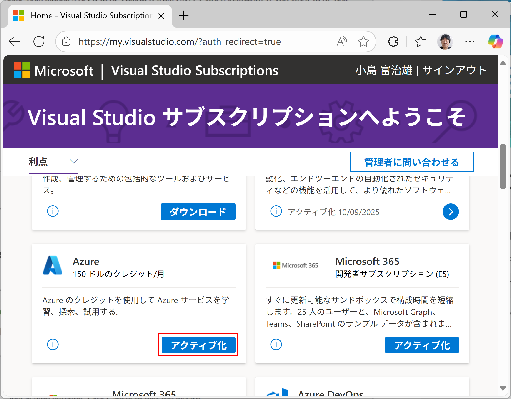

- **それ以外の場合**
  [Azure アカウントの作成 - .NET | Microsoft Learn](https://learn.microsoft.com/ja-jp/dotnet/azure/create-azure-account) を参考に作成します。

> [!WARNING]
> Azure OpenAI は使った分だけ **課金される場合があります**。セミナー後に不要になったら、リソース グループごと削除しておくと安心です。

#### ② Azure OpenAI リソースを作る

1. [Azure Portal](https://portal.azure.com) を開き、「**リソースの作成**」をクリックします。

   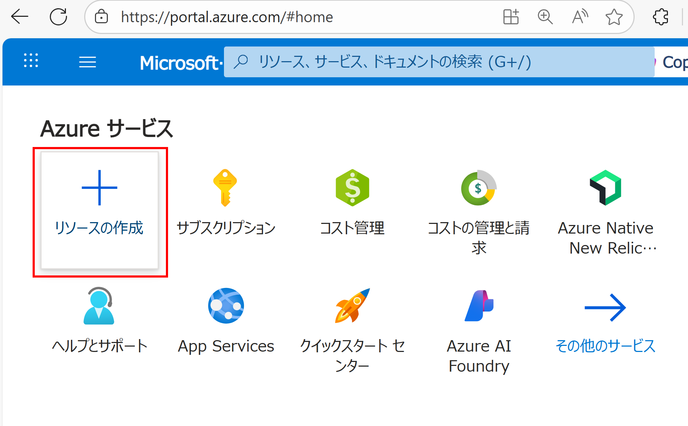

2. 「**Azure OpenAI**」で検索し、「Azure OpenAI」をクリックします。

   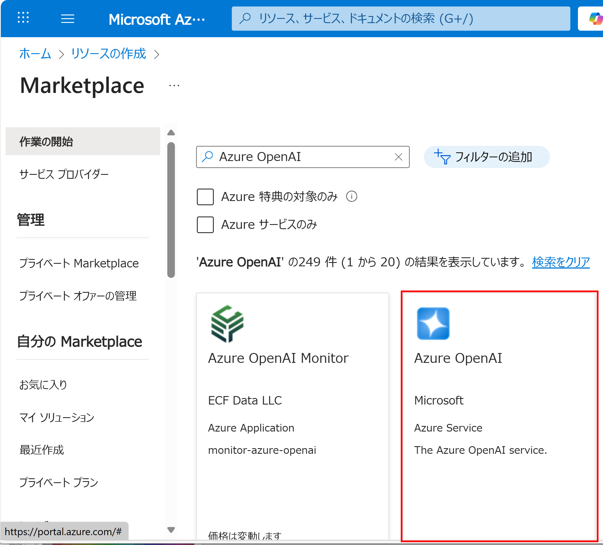

3. 「**作成**」をクリックします。

   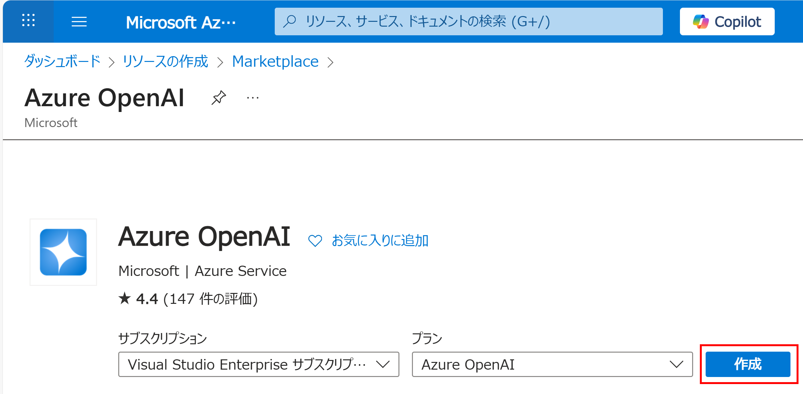

4. **リソース グループ** は「新規作成」で作ります (名前は自由。例: `rg-aichat`)。

   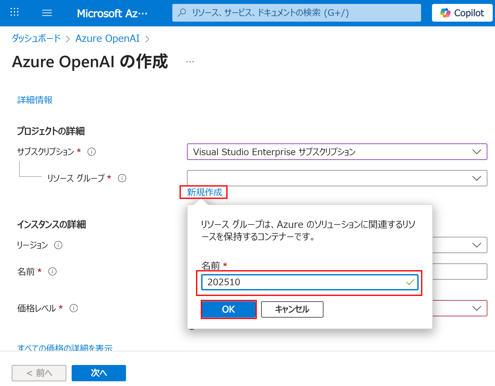

5. リージョン・名前・価格レベルを入力し、「次へ」を 3 回クリックします。
   **「名前」は世界中で重複しない文字列にしてください** (例: `aichat-yourname-2026`)。

   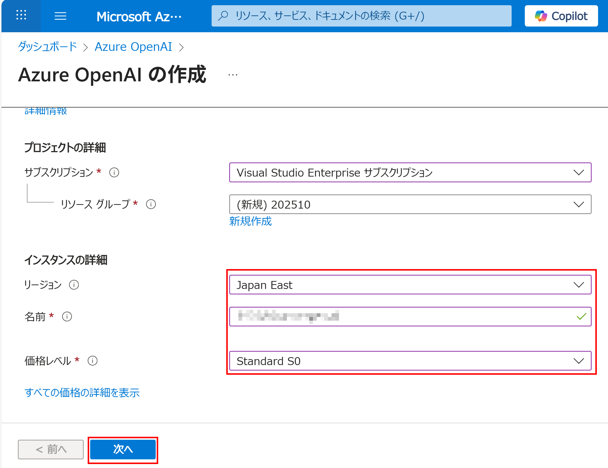

6. 内容を確認して「**作成**」をクリックします。

   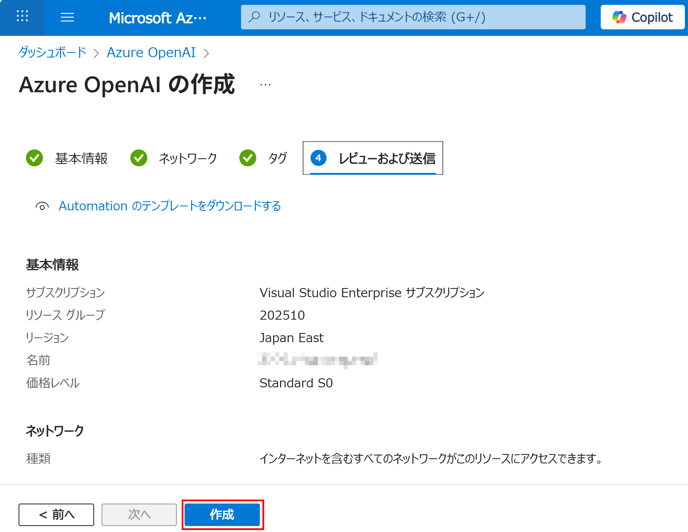

7. デプロイが終わったら「**リソースへ移動**」をクリックします。

   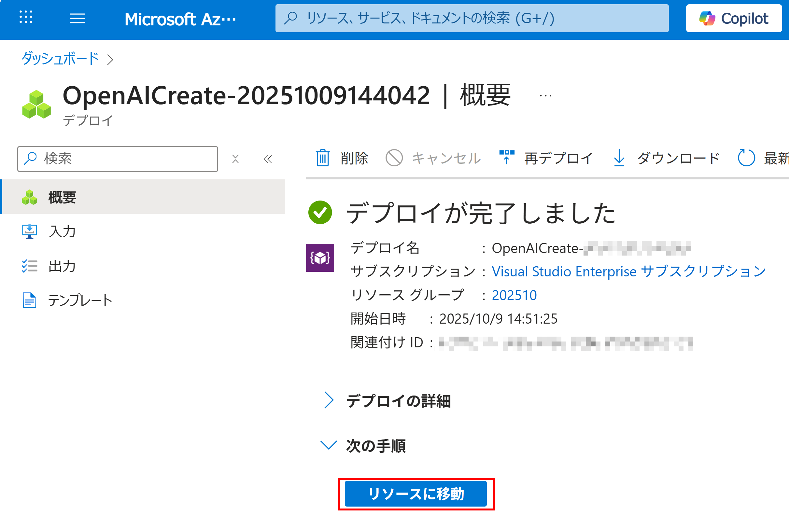

#### ③ エンドポイントと API キーをメモする

1. 「**Azure AI Foundry ポータルへ移動**」をクリックします。

   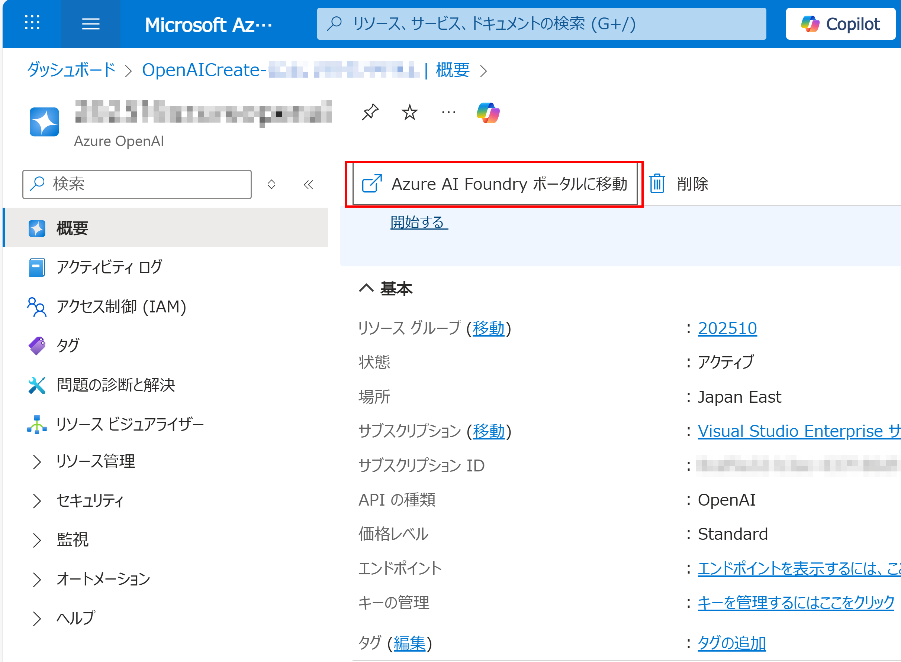

2. 「**API キー**」と「**Azure OpenAI エンドポイント**」をコピーし、メモ帳などに控えておきます。

   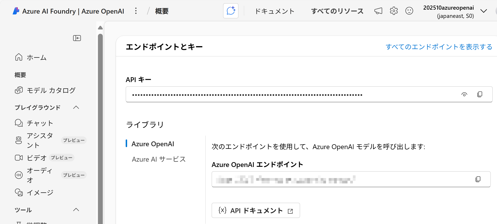

> [!CAUTION]
> API キーはパスワードと同じです。ソースコードや GitHub に載せないでください。

#### ④ gpt-5-mini モデルをデプロイする

1. 「**チャット**」を選び、「**デプロイの作成**」をクリックします。

   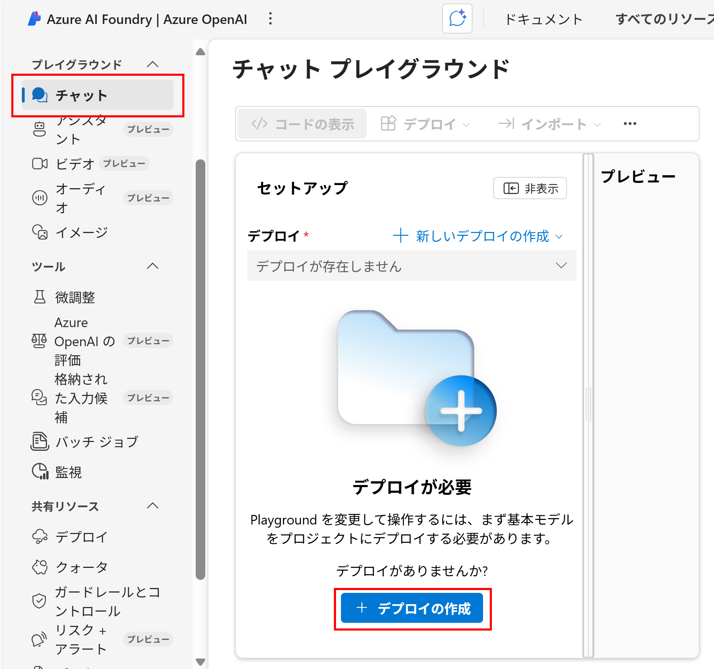

2. 「**gpt-5-mini**」を選び、「確認」をクリックします。

   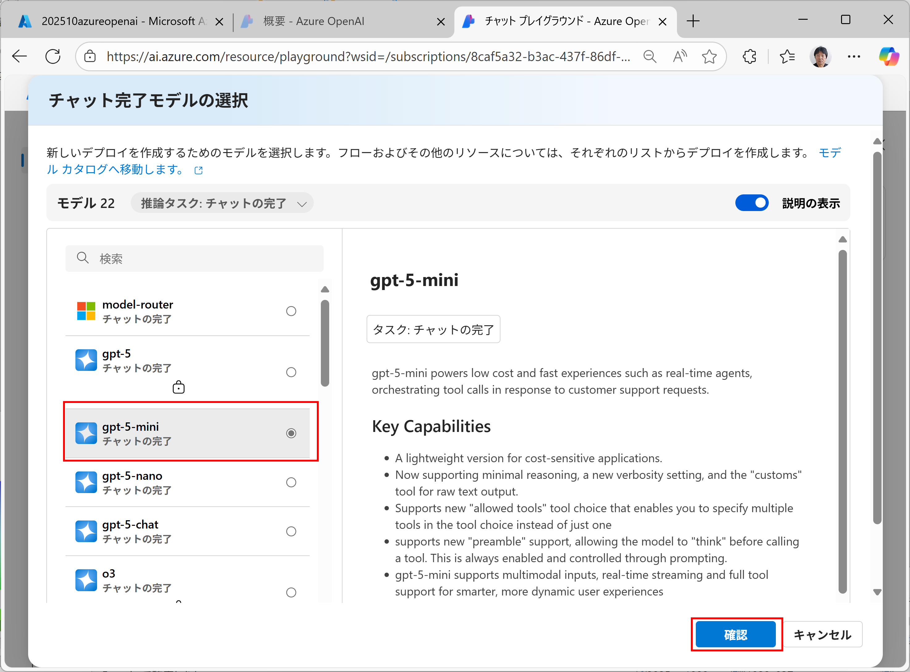

3. 「**デプロイ**」をクリックします。**デプロイ名は `gpt-5-mini` のまま** にしておくと、アプリの設定が不要になります。

   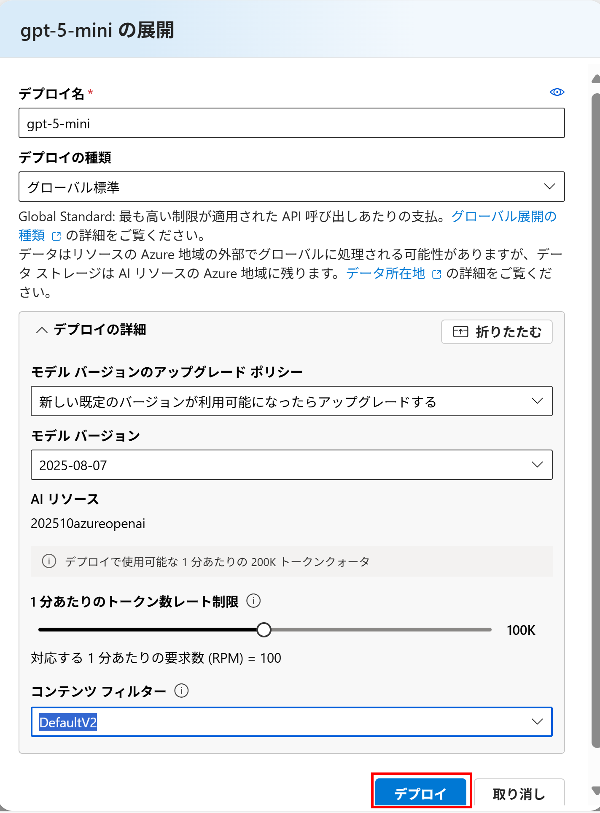

これで、次の 3 つが手に入りました。

| 項目 | 例 |
|---|---|
| エンドポイント | `https://aichat-yourname-2026.openai.azure.com/` |
| API キー | `abcd1234...` (長い英数字) |
| デプロイ名 | `gpt-5-mini` |

### 3.3 Brave Search API キーの準備

AI エージェントの Web 検索ツールに使います。

1. [Brave Search API](https://brave.com/search/api/) にアクセスし、アカウントを登録します。
2. プラン (無料プランあり) を選んで申し込みます。
3. ダッシュボードの「API Keys」から API キーを発行し、控えておきます。

> [!IMPORTANT]
> このアプリでは、AI エージェントの初回起動時に Brave Search MCP サーバーへ接続します。**Brave Search の API キーが未設定だと AI エージェントが応答できません** (エラーメッセージが返ります)。

### 3.4 ソースコードの取得

```bash
git clone https://github.com/Fujiwo/Shos.AIChatSample.git
cd Shos.AIChatSample
```

Visual Studio を使う場合は、`Shos.AIChatSample.slnx` をダブルクリックして開きます。

### 3.5 API キーなどの設定

API キーは秘密情報なので、`appsettings.json` には **書かず**、**User Secrets** (開発用の秘密情報の保存場所。ソースコードの外に保存される) に設定します。

#### 方法 A: Visual Studio で設定する

1. ソリューション エクスプローラーで `Shos.AIChatSample` プロジェクトを右クリックし、「**ユーザー シークレットの管理**」を選びます。
2. 開いた `secrets.json` に、次のように書いて保存します。

```json
{
  "ChatAgent": {
    "Endpoint": "https://aichat-yourname-2026.openai.azure.com/",
    "ApiKey": "Azure OpenAI の API キー",
    "DeploymentName": "gpt-5-mini",
    "BraveApiKey": "Brave Search の API キー"
  }
}
```

#### 方法 B: コマンドで設定する

リポジトリのルート フォルダーで実行します。

```bash
dotnet user-secrets set "ChatAgent:Endpoint"    "https://aichat-yourname-2026.openai.azure.com/" --project Shos.AIChatSample
dotnet user-secrets set "ChatAgent:ApiKey"      "Azure OpenAI の API キー"                        --project Shos.AIChatSample
dotnet user-secrets set "ChatAgent:BraveApiKey" "Brave Search の API キー"                        --project Shos.AIChatSample
```

#### 方法 C: 環境変数で設定する

User Secrets に設定がない項目は、次の環境変数から読み込まれます。

| 環境変数 | 内容 |
|---|---|
| `AZURE_OPENAI_ENDPOINT` | Azure OpenAI のエンドポイント |
| `AZURE_OPENAI_API_KEY` | Azure OpenAI の API キー |
| `BRAVE_API_KEY` | Brave Search の API キー |

```bash
setx AZURE_OPENAI_ENDPOINT "https://aichat-yourname-2026.openai.azure.com/"
setx AZURE_OPENAI_API_KEY  "Azure OpenAI の API キー"
setx BRAVE_API_KEY         "Brave Search の API キー"
```

> `setx` で設定した環境変数は、**新しく開いた** コマンドプロンプトや Visual Studio から有効になります。

#### 設定項目のまとめ

| 設定キー (`ChatAgent:` 〜) | 内容 | 既定値 | 代わりに使われる環境変数 |
|---|---|---|---|
| `Endpoint` | Azure OpenAI のエンドポイント | (なし・必須) | `AZURE_OPENAI_ENDPOINT` |
| `ApiKey` | Azure OpenAI の API キー | (なし・必須) | `AZURE_OPENAI_API_KEY` |
| `DeploymentName` | モデルのデプロイ名 | `gpt-5-mini` | — |
| `BraveApiKey` | Brave Search の API キー | (なし・必須) | `BRAVE_API_KEY` |

> [!NOTE]
> 設定が足りなくてもアプリ自体は起動します。設定の不足に気づくのは、最初に `@Agent` で話しかけたとき (エラーメッセージが返る) です。

### 3.6 データベースの作成

このアプリは、**1 つのデータベースを 2 つの DbContext で使っています**。

| DbContext | 中身 | マイグレーションの場所 |
|---|---|---|
| `ApplicationDbContext` | ユーザー情報 (ログイン用) | `Migrations/` |
| `MessagesDbContext` | チャットメッセージ | `Migrations/MessagesDb/` |

そのため、テーブルを作るときは **両方に対して** マイグレーションを適用する必要があります。
接続先は `appsettings.json` の `ConnectionStrings:DefaultConnection` で、既定では LocalDB (`(localdb)\mssqllocaldb`) です。データベースは自動で作られるので、事前の準備は不要です。

#### 方法 A: Visual Studio (パッケージ マネージャー コンソール) で作る

「ツール」→「NuGet パッケージ マネージャー」→「パッケージ マネージャー コンソール」を開き、次の 2 行を実行します。

```powershell
Update-Database -Context ApplicationDbContext
Update-Database -Context MessagesDbContext
```

#### 方法 B: コマンドで作る

初回のみ、EF Core のコマンドライン ツールをインストールします。

```bash
dotnet tool install --global dotnet-ef
```

リポジトリのルート フォルダーで、次の 2 行を実行します。

```bash
dotnet ef database update --project Shos.AIChatSample --context ApplicationDbContext
dotnet ef database update --project Shos.AIChatSample --context MessagesDbContext
```

> [!TIP]
> `--context` を付け忘れると「More than one DbContext was found」というエラーになります。

<details>
<summary>(開発者向け) テーブルの構成を変更したいとき</summary>

`Message` クラスなどを変更したら、マイグレーションを追加してから適用します。

```bash
dotnet ef migrations add <マイグレーション名> --project Shos.AIChatSample --context MessagesDbContext --output-dir Migrations/MessagesDb
dotnet ef database update --project Shos.AIChatSample --context MessagesDbContext
```

</details>

### 3.7 起動して使ってみる

#### 起動する

- **Visual Studio**: 上部の実行ボタン (▶ https) をクリックします (または F5 キー)。
- **コマンド**:

  ```bash
  dotnet run --project Shos.AIChatSample --launch-profile https
  ```

  ブラウザーで https://localhost:7274 を開きます。

> 初回は開発用 HTTPS 証明書の信頼を求められることがあります。「はい」を選んでください (コマンドの場合は `dotnet dev-certs https --trust`)。

#### ユーザー登録とログイン

1. 画面右上の「**Register**」から、メールアドレスとパスワードを入力して登録します。
2. 「**Click here to confirm your account**」というリンクが表示されるので、クリックしてアカウントを確認済みにします。
   (このサンプルはメールを送信しないため、画面上のリンクで確認します)
3. 「**Login**」からログインすると、チャット画面が表示されます。

#### チャットしてみる

1. 入力欄にメッセージを入力し、「Send Message」(または Enter キー) で送信します。
2. `@Agent こんにちは` のように `@Agent` を付けると、AI エージェントが返事をします。
   - 初回は Brave Search MCP サーバーのダウンロードと起動があるため、少し時間がかかります。
3. 別のブラウザー (またはシークレット ウィンドウ) で別のユーザーとしてログインすると、グループチャットの様子を確認できます。

---

## 4. うまく動かないとき

| 症状 | 原因と対処 |
|---|---|
| 起動時やログイン時に DB のエラー画面が出る | マイグレーションが未適用です。[3.6](#36-データベースの作成) の **2 つ** のコマンドを実行してください |
| `More than one DbContext was found` | `dotnet ef` コマンドに `--context` を付けてください |
| `@Agent` に「(エラーが発生したため応答できませんでした)」と返る | 設定 (エンドポイント・API キー・デプロイ名・Brave API キー) を確認してください。詳しい原因はコンソールのログに出ます |
| ログに `Please set the ... environment variable` | 該当する設定が未設定です。[3.5](#35-api-キーなどの設定) を参照してください |
| ログに `DeploymentNotFound` / 404 | Azure 側のデプロイ名と `ChatAgent:DeploymentName` が一致していません |
| ログに `npx` が見つからない旨のエラー | Node.js がインストールされていないか、PATH が通っていません。インストール後、Visual Studio / ターミナルを再起動してください |
| 登録後にログインできない | 登録直後に表示される確認リンクをクリックしていません。別のメールアドレスで登録し直し、表示されたリンクを必ずクリックしてください |
| AI が前の話を忘れた | AI との会話の記憶はメモリ上に保存しているため、アプリを再起動すると消えます (仕様) |

---

## 5. ライセンス

[MIT License](LICENSE.txt) © 2026 Fujio Kojima
